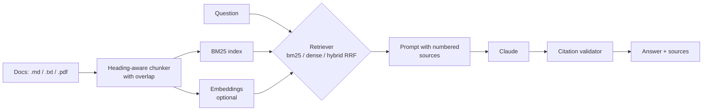

# Volcano Docs Q&A: Retrieval-Augmented Generation with Citations

Ask natural-language questions about volcano hazards and USGS monitoring, and get short answers **grounded in a document collection, with numbered citations that are verified** against what was actually retrieved.

Built with **Python, FastAPI, a from-scratch BM25 retriever, optional dense embeddings with hybrid rank fusion, and Claude**, plus an evaluation harness for both retrieval and answer quality.



## How it works

1. **Ingest and chunk.** Documents are split on markdown headings, then packed into chunks of about 900 characters, with one paragraph of overlap so facts on a boundary aren't lost. Each chunk keeps its document title and section heading.
2. **Retrieve.**
   - **BM25**, implemented from scratch in `rag/retrieval.py`: term frequency with length normalization and IDF.
   - **Dense**: cosine similarity over sentence embeddings (`sentence-transformers`, runs locally for free).
   - **Hybrid**: Reciprocal Rank Fusion of both. RRF combines rankings without needing BM25 and cosine scores on the same scale.
3. **Generate.** The top chunks go to Claude as `<source id="n">` blocks. The system prompt requires a citation on every claim, and an exact refusal string when the answer isn't in the sources.
4. **Verify.** Citations are parsed and checked. A citation to a source that wasn't retrieved marks the answer `grounded: false`, and the UI shows a warning.
5. **Degrade gracefully.** Without an API key, the app runs in retrieval-only mode and returns the best passage.

## Quickstart

```bash
python -m venv .venv && source .venv/bin/activate
pip install -r requirements-dev.txt
cp .env.example .env    # add ANTHROPIC_API_KEY
export $(grep -v '^#' .env | xargs)

uvicorn rag.main:create_app --factory --reload     # http://localhost:8000
python -m rag.cli "Why is Mount Rainier a lahar risk?"
```

**Add your own documents.** Drop `.md`, `.txt`, or `.pdf` files into `data/docs/` and restart. USGS Fact Sheets are public domain and make a great real corpus.

## Evaluation

```bash
python -m evals.run_eval                      # retrieval metrics, BM25
pip install sentence-transformers
python -m evals.run_eval --mode hybrid        # compare
python -m evals.run_eval --answers            # also grade Claude's answers
```

`evals/questions.jsonl` holds 38 questions:

- 25 direct questions
- 10 **paraphrased** questions that avoid the documents' wording (for example "breathing the dust" instead of "ash")
- 3 out-of-scope questions the assistant must decline

| Retriever | Recall@1 | Recall@3 | MRR | Grounded | Refusal acc. |
|---|---|---|---|---|---|
| BM25 | 0.914 | 0.943 | 0.929 | not yet measured | not yet measured |
| Hybrid (BM25 + MiniLM) | not yet measured | | | | |

BM25 misses are vocabulary mismatches, such as *"died"* vs. *"killed"* and *"dust"* vs. *"ash"*. That's exactly the gap dense embeddings close, and it's why the hybrid mode exists. Results, including every miss, are written to `evals/results/`.

> The sample corpus in `data/docs/` is short summaries written for this demo from public information. Swap in real USGS publications for a stronger project.

## Tests

`pytest -q` covers:

- chunking (heading boundaries and overlap)
- BM25 ranking and IDF behavior
- dense, hybrid, and RRF retrieval
- prompt construction and citation parsing
- hallucinated-citation detection
- retrieval-only mode
- HTTP endpoints
- a retrieval-quality regression guard (recall@3 ≥ 0.9)

## Ideas to extend

- Store embeddings in **PostgreSQL + pgvector** instead of memory.
- Add a re-ranker (cross-encoder) after hybrid retrieval.
- Stream answers token-by-token with server-sent events.
- Use LLM-as-judge to grade answer correctness, not just citations.
